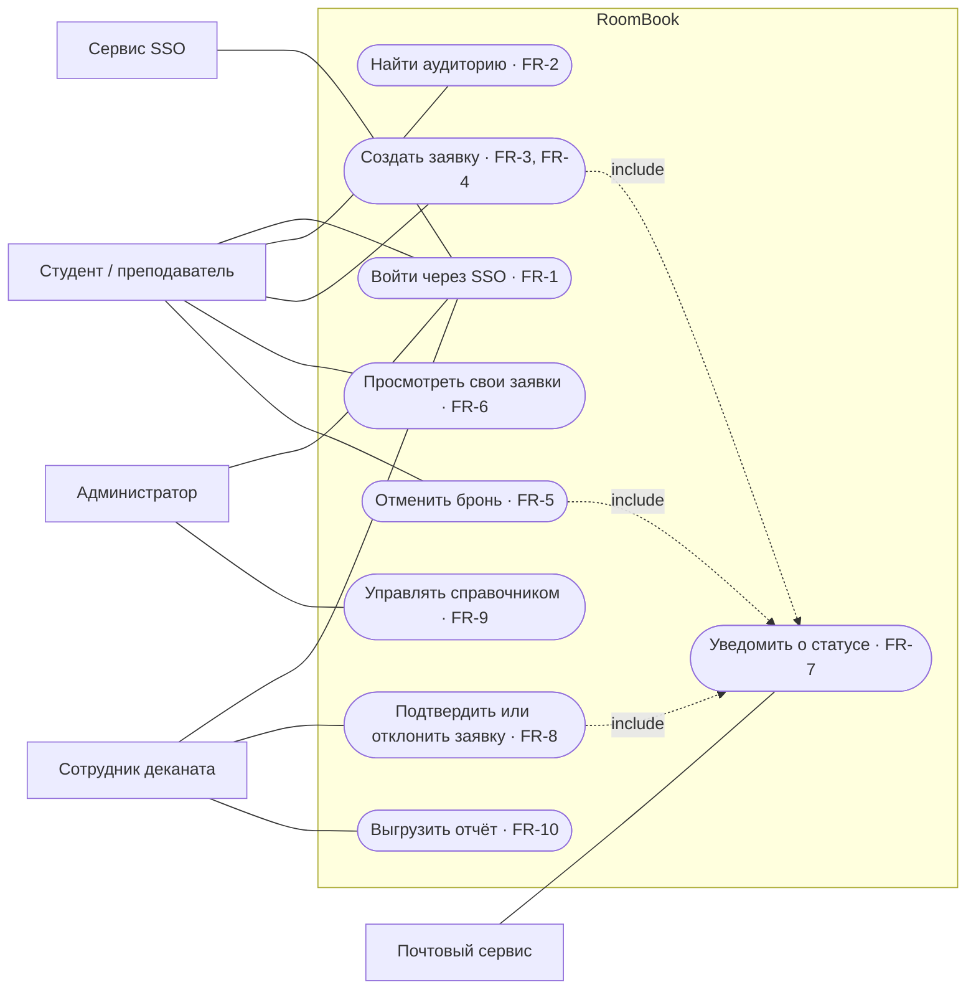
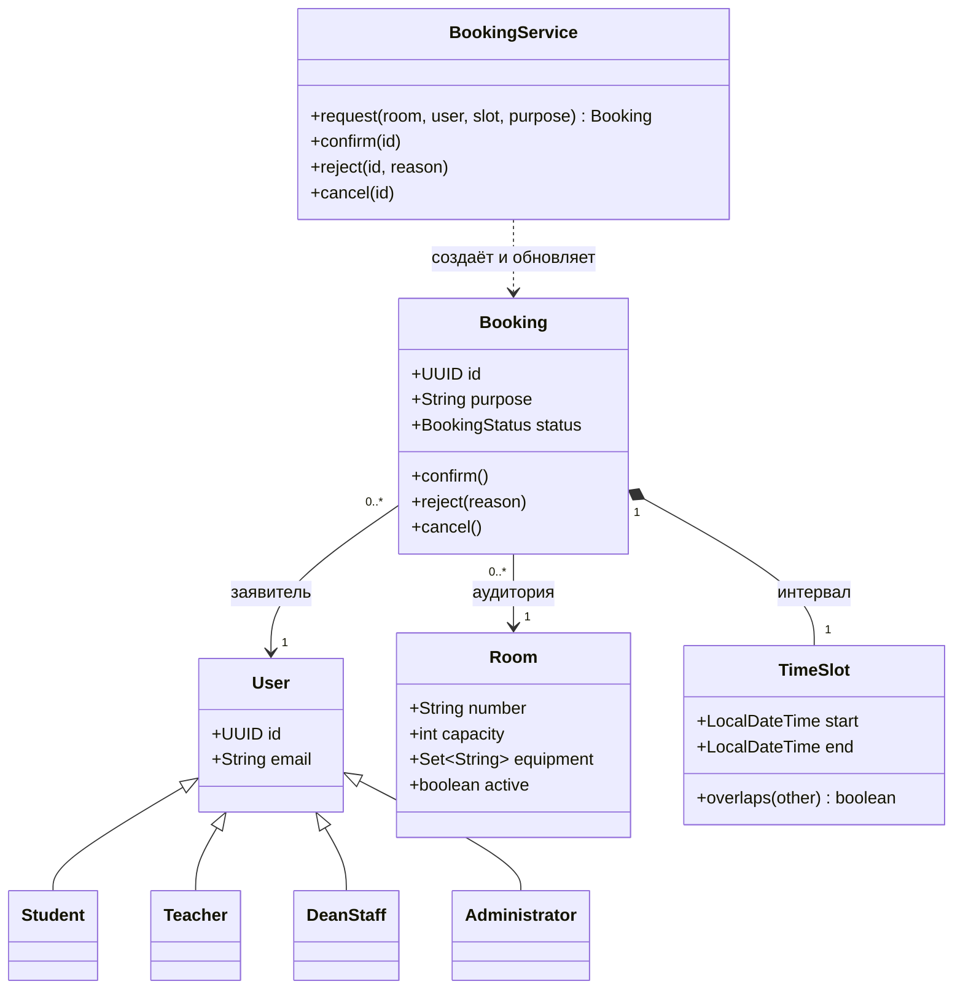
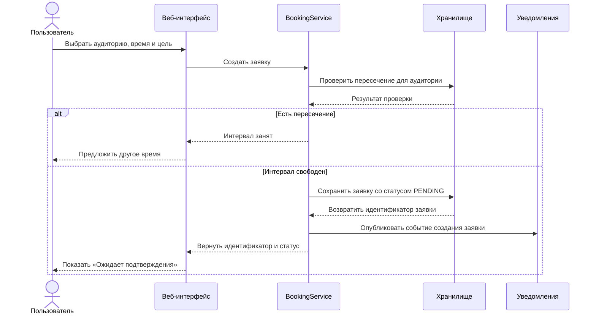

# UML-диаграммы RoomBook

Диаграммы описывают целевую систему из SRS практической №2. Консольный прототип практической №3 реализует создание и подтверждение заявки, проверку пересечений и выгрузку списка в CSV.

## Варианты использования

## Диаграмма классов

## Создание бронирования

В целевой системе проверка пересечения и запись выполняются атомарно. Уведомление инициируется после сохранения заявки.
